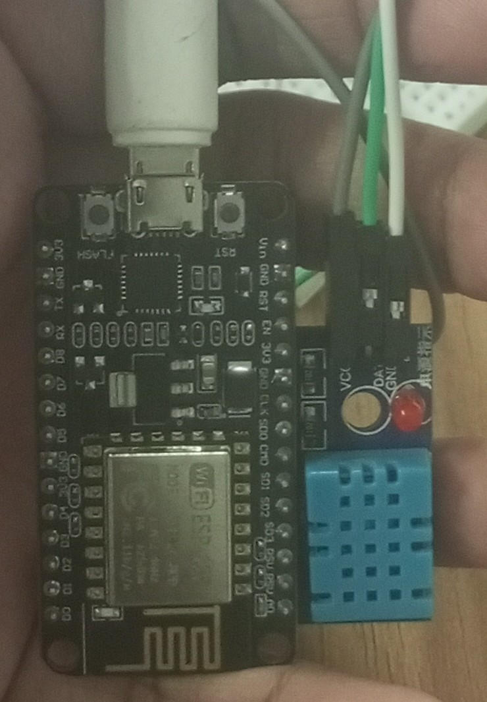
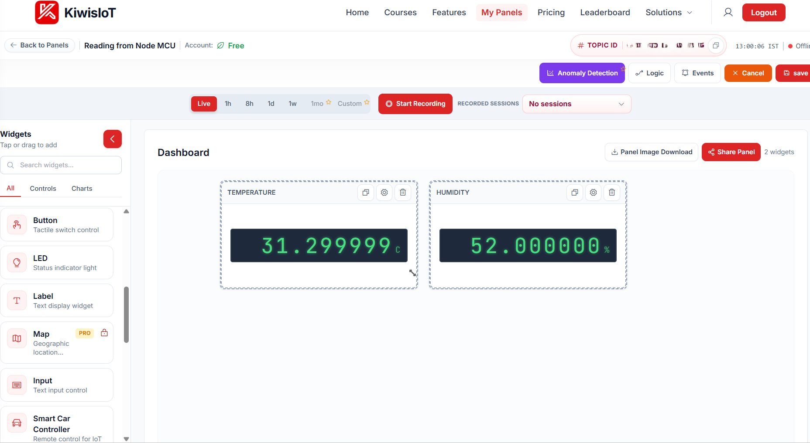

# Temperature-and-Humidity-Reading-using-KiwisIot-platform
# KiwisIoT DHT11 Temperature and Humidity Monitoring
# Description
An IoT-based project using NodeMCU ESP8266 and a DHT11 sensor to measure temperature and humidity and monitor the readings through the KiwisIoT platform.
# Components Required
- NodeMCU ESP8266
- DHT11 Temperature and Humidity Sensor
- Breadboard
- Connecting Wires
# Working
- DHT11 sensor detects the surrounding temperature and humidity.
- Temperature is measured in Celsius (°C).
- Humidity is measured in percentage (%).
- Both readings are sent to separate widgets on the KiwisIoT dashboard.
# Project Images

# Source Code
[View Source Code](dhtiot.ino)
# Technologies Used
- Arduino IDE
- NodeMCU ESP8266
- DHT11 Sensor
- KiwisIoT
- Embedded C++
